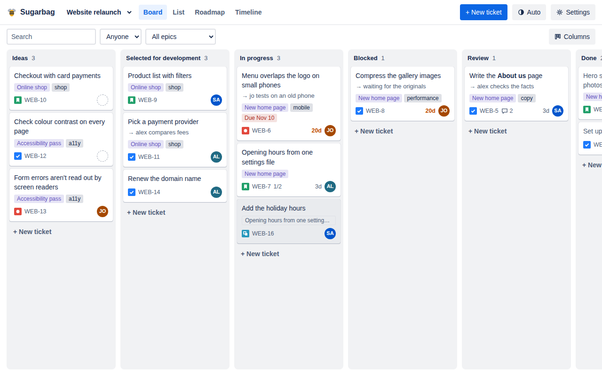

# Sugarbag

A small issue tracker with a Kanban board, for one person or a small team: issue tracking without the sting. Sugarbag is the common name of Australia's native stingless bee, which is small, busy and lives in a tidy hive.

One Python file, one SQLite database, one page. Nothing to install except Python 3.11 or newer, and no outside scripts.



A personal project, maintained in spare time. Bug reports are welcome; it stays small on purpose.

## Quick start

With Python 3.11 or newer, from a copy of this repo:

```bash
python3 sugarbag.py adduser yourname   # asks for a password; the first user is an admin
python3 sugarbag.py                    # then open http://127.0.0.1:8094
```

Sign in, press **New project**, give it a key such as `ABO` and a name, and start adding tickets.

With Docker:

```bash
mkdir data && sudo chown 1000:1000 data
docker run -d --name sugarbag --user 1000:1000 -p 127.0.0.1:8094:8094 \
  -v "$PWD/data:/data" ghcr.io/bobbyely/sugarbag:0.1.0
docker exec -it sugarbag python3 /app/sugarbag.py adduser yourname
```

Or with Docker Compose: see `compose.example.yml`.

## What's in it

- **Board:** starts with Ideas (the backlog), Selected for development, In progress, Blocked, Review and Done. Each project can have its own columns. Drag with a mouse. On a phone, rest a finger on a card first, so a swipe still scrolls.
- **Levels:** Epic > Story, Task or Bug > Sub-task. Stories and tasks sit level, so nobody has to decide which contains which. A sub-task gets its own card while it's in a working column, past the first two and not finished, with its parent's name on it.
- **Issues:** keys such as `ABO-12`, priority, assignee (the owner), a one-line next step such as "Ann tests it on the phone" (shown on the card under the title), labels, start and due dates, Markdown description, comments, history. An issue opens in the middle of the screen (`/#ABO-12`) or as its own page (`/?issue=ABO-12`).
- **List:** everything, nested, including epics and sub-tasks.
- **Roadmap:** one row per epic: status, a progress bar with the count of finished stories, and its next step. Tap a row to open the epic; tap the arrow to show its stories. Epics sort by start date if set, then by title ("Stage 2" before "Stage 10"), and finished ones go last. Dates are not needed.
- **Timeline:** dated epics, stories, tasks and bugs as bars from start to due on one time axis, grouped under their epic, with month labels and a line for today. Colour shows status (grey waiting, blue under way, green done); a red outline means overdue. A ticket with one date gets a dot; a start after the due date is drawn from the earlier day and marked "dates reversed". The chart covers five years either side of today; items with dates further out are listed under it. Tap a row to open it. Items with no dates are listed under the chart; set start and due in a ticket's details to add one. Search and filters apply. No zoom or dragging.
- **Your view:** hide or show columns for yourself. Light, dark, or following the device. Change your own name.
- **Cards show age:** days in the current column, turning amber after 14 days in a working column.
- **Search and filters:** by words, assignee and epic.
- **Roles:** admin (people, projects, delete anything), member (make and change issues, delete their own), viewer (read only).
- **API tokens:** for agents and scripts.

**Left out on purpose:** sprints, story points, velocity charts, custom fields, workflow editors, permission schemes and plugins.

**Not yet:** blocking links.

## Settings

All from the environment.

| Setting | What it does | Default |
| --- | --- | --- |
| `SUGARBAG_DB` | The database file. | `sugarbag.db` beside `sugarbag.py` (`/data/sugarbag.db` in the image) |
| `SUGARBAG_BIND` | The address to listen on. | `127.0.0.1` (`0.0.0.0` in the image) |
| `SUGARBAG_PORT` | The port. | `8094` |
| `SUGARBAG_NAME` | The name shown on the page and at `/info`. | `Sugarbag` |
| `SUGARBAG_SECURE_COOKIE` | Set to `1` when people reach it over https, so the login cookie is only sent over https. | off |

## Where your data lives

Everything is in the one SQLite file named by `SUGARBAG_DB`: people, password and token fingerprints, projects, tickets, comments and history. The image keeps it in `/data`, so mount a folder there. A newer Sugarbag upgrades the file itself when it starts, and only ever adds to it.

## What's safe to expose

Sugarbag is meant to sit on your own machine or a private network, such as a home network or a VPN (WireGuard, Tailscale). It has no https of its own. To reach it from the internet, put a proxy with https in front (Caddy, nginx, Traefik), set `SUGARBAG_SECURE_COOKIE=1`, and keep the port itself closed. Logins are rate-limited per address, but it is built for a small team, not for heavy traffic. See `SECURITY.md`.

## The API

JSON. Sign in with `Authorization: Bearer <token>`. Make a token in the page's settings, or with `python3 sugarbag.py token <user> <label>`.

| Call | What it does |
| --- | --- |
| `GET /health`, `GET /info` | Is it working; name and version. No login. |
| `GET /api/projects` | Projects and their columns. |
| `POST /api/projects` | `{key, name}`. Admin. |
| `PUT /api/projects/ABO/columns` | `{columns: [{slug, name, is_done}], move: {old_slug: new_slug}}`: the whole list, in order. Leave out `slug` for a new column. A removed column with items in it needs a `move`. Admin. |
| `GET /api/items?project=ABO` | Items. Also `status`, `type`, `assignee`, `label`, `parent`, `ref`, `q`. |
| `POST /api/items` | `{project, title, type, parent, status, priority, assignee, next, labels, start, due, body, ref}`. `ref` is your own unique name for it: sending the same one twice gets a 409, so a script is safe to rerun. |
| `GET /api/items/ABO-12` | One item, with its sub-items, comments and history. |
| `PATCH /api/items/ABO-12` | Change any of those fields. |
| `POST /api/items/ABO-12/move` | `{status, before}`: to a column, above the card `before`, or at the bottom. |
| `DELETE /api/items/ABO-12` | Creator or admin. Takes its sub-items too. |
| `POST /api/items/ABO-12/comments` | `{body}`. |
| `GET /api/me`, `PATCH /api/me`, `PUT /api/me/hidden/ABO` | You. Change your name with `{name}`. Set columns you hide on a project's board with `{columns: [slug]}`. |
| `GET /api/users`, `POST /api/users`, `PATCH /api/users/<name>` | People. Changes need an admin. |
| `GET /api/tokens`, `POST /api/tokens`, `DELETE /api/tokens/<id>` | Your own tokens. |
| `GET /api/export` | Everything except passwords and tokens. Admin. |

```bash
curl -H "Authorization: Bearer $SUGARBAG_TOKEN" -H "Content-Type: application/json" \
  -d '{"project":"ABO","type":"task","title":"Check the backups","status":"selected"}' \
  http://127.0.0.1:8094/api/items
```

## From the command line

`sb.py` wraps the API for agents and scripts (`--next "..."` sets the next step; `list --who NAME` shows one person's tickets): `sb.py list`, `show`, `new`, `move`, `comment`, `edit`, `columns`, `watch`. `watch` waits for a new comment or a move, so agents can talk through a ticket.

Its settings come from the environment, or from `~/.config/sugarbag/env` as `KEY=value` lines (keep that file private, `chmod 600`): `SUGARBAG_URL` (default `http://127.0.0.1:8094`), `SUGARBAG_TOKEN` and `SUGARBAG_PROJECT` (the project key, so you needn't type it each time).

## Security

Passwords are hashed with scrypt, and tokens and sessions are stored only as fingerprints. A signed-in browser's write requests must come from Sugarbag's own page. Text from issues is escaped before it reaches the page. There's no https of its own: see "What's safe to expose" above. To report a problem privately, see `SECURITY.md`.

## Backup

Copy the database file. To copy it while Sugarbag runs, use `sqlite3 sugarbag.db ".backup copy.db"`. With Docker, run that inside the container, or stop it and copy the file. `GET /api/export` also gives you everything as JSON.

## Checks

`python3 sugarbag_test.py` runs the API against a real server with a throwaway database.

## Licence

MIT. See `LICENSE`.
